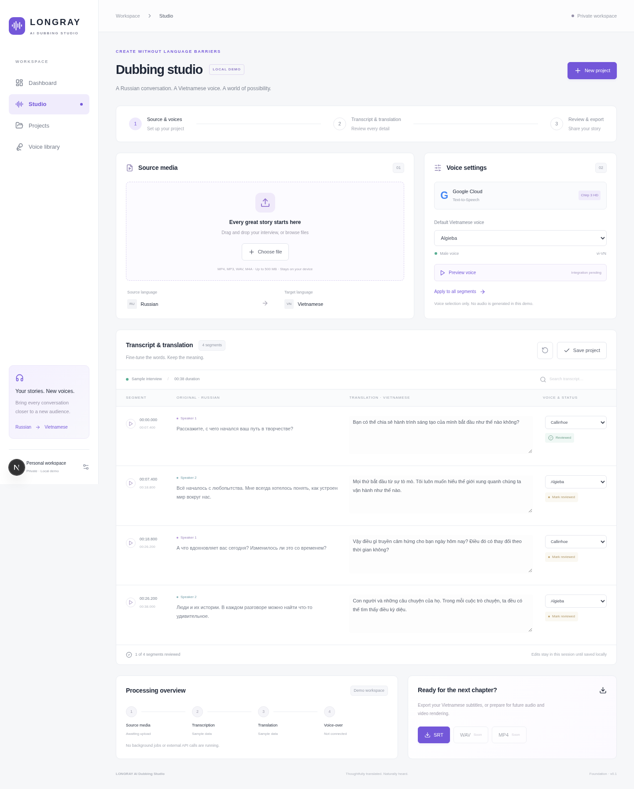

# LONGRAY AI Dubbing Studio

A private, browser-based workspace for translating Russian interviews into Vietnamese. Task 01 is a functional **local demo**, not a production dubbing pipeline. The owner uses only a browser; the commands below are for developers and the hosted development environment. No Intel Mac software installation is required to use the hosted UI. Production hosting and authentication are future work; do not expose this demo as a private production service.

## Development

Use Node.js 22.13+ (Node 24 recommended) and npm. From this checkout:

```sh
npm ci
npm run dev
```

Validation: `npm run typecheck`, `npm run lint`, `npm test`, `npm run build`. Browser tests: `npx playwright install chromium` then `npm run test:e2e`. Production startup after a build: `npm start`. No environment variables are required. See `.env.example` for future server-only configuration; never commit credentials or place secrets in `NEXT_PUBLIC_` variables.

## What works

- Responsive dashboard, studio, and voice library, with keyboard-accessible labeled controls.
- Local MP4, MP3, WAV, M4A selection or drag-and-drop, validation, and native playback. Supported playback codecs depend on the browser. Files remain on the device; 500 MB limit. Selecting media does not produce a transcript.
- Four Russian interview sample segments with editable Vietnamese translations, timestamps, speaker identities, per-segment voice assignment, review toggles, search, and default voice assignment.
- Explicit save/restore using browser localStorage, and a fresh demo project action. One saved project per browser; media files are never persisted. Reload and use Restore to recover saved edits. Clearing browser data deletes the saved project.
- Real UTF-8 SRT download from current translations and timestamps.
- Google Chirp 3 HD selection: vi-VN Algieba, Orus, Umbriel (male), Callirrhoe, Despina (female).

## Deliberate mock boundaries

The source transcript and initial translations are fixtures. Review is a human editing state, not a processing job. Voice Preview explains that synthesis is pending and does not play substitute audio. WAV and MP4 exports are disabled until real synthesis and rendering exist. No transcription, translation, upload, synthesis, backend jobs, API calls, paid infrastructure, deployment, or production authentication has been implemented.

The referenced `LONGRAY_AI_Dubbing_Studio_Codex_Spec_v1.0.md` was not available in the provided checkout or attachment context. Implementation follows the detailed Task 01 prompt, including its five voice overrides. Reconcile the full specification before expanding scope.

## Architecture

- `src/app`: Next.js App Router entry points, metadata, and Tailwind/CSS styling. No remote fonts or assets required.
- `src/components/studio.tsx`: client workspace and local state; reusable badge and voice preview components.
- `src/types/studio.ts`: project, segment, voice types and the authoritative voice catalog.
- `src/lib/demo.ts`: isolated fixtures, timestamp formatting, input validation, SRT serialization.
- `src/lib/services.ts`: typed contracts for Deepgram recognition, OpenAI translation, Google TTS, R2 signed uploads/downloads, and a background worker. Contracts have no implementation and are never instantiated in the demo.
- `tests`: unit coverage for export formatting and upload validation; Playwright coverage for editing, persistence, voice selection, export, navigation, and invalid uploads.

Keep real provider adapters server-only. A future browser client should use authenticated server endpoints, signed media URLs, and durable job IDs. Vercel can host the Next.js UI and short API operations; long-running transcription, alignment, FFmpeg rendering, and retries belong in a separate worker. Do not perform long media jobs in a Vercel request.

## Recommended Task 02

1. Reconcile the full specification; define private authentication, durable project storage, media limits, retention, and deletion.
2. Implement authenticated R2 signed uploads with server-side MIME/size validation and project ownership checks.
3. Add a durable worker job lifecycle, progress polling, cancellation, retries, and observable failures.
4. Integrate Deepgram diarized Russian transcription and OpenAI translation through server adapters; persist editable segments with versioning.
5. Add Google Chirp 3 HD previews and synthesis for the five selected vi-VN voices, then timing alignment and tested WAV/SRT/MP4 rendering.
6. Validate on Intel Mac Safari/Chrome, add security and end-to-end pipeline checks, and separately approve deployment and cost limits.

No deployment or paid resources are part of Task 01.

## Interface previews



[Mobile screenshot](docs/screenshots/studio-mobile.png)

In this cloud environment, use `PLAYWRIGHT_CHROMIUM_EXECUTABLE_PATH=/usr/bin/chromium npm run test:e2e` to reuse installed Chromium. Browser tests wait for client hydration, so they exercise React state rather than only server-rendered markup. The initial form is inert until hydrated to prevent lost edits during first load.

## Task 01.5 — private test hosting

See [Vercel deployment instructions](docs/VERCEL_DEPLOYMENT.md). On Vercel, `STUDIO_ACCESS_PASSWORD` (at least 16 characters, server-only) is mandatory; the username is `longray`. Missing configuration fails closed. Existing UI and demo functionality are unchanged. No paid providers or infrastructure are required. Vercel publication must be verified separately from the local build; a real deployment URL is provided only after Vercel reports it.
